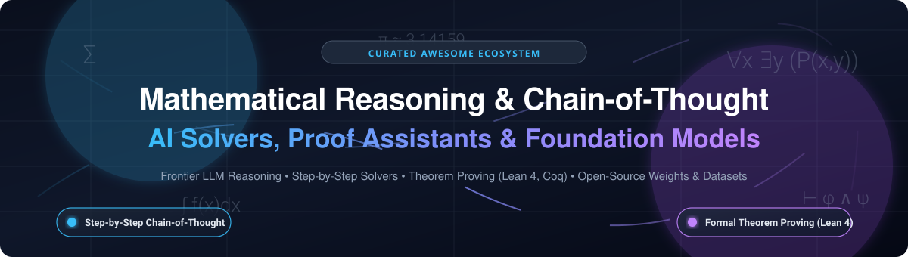

# 🧠 Awesome Mathematical Reasoning & Chain-of-Thought AI 📐

**A curated index of state-of-the-art Mathematical Reasoning AI, Chain-of-Thought (CoT) LLMs, Automated Theorem Proving (ATP) systems, and Step-by-Step Computational Engines.** 🚀

[Explore SaaS Platforms](#-saas--hosted-platforms) • [Explore Open-Source Tools](#-open-source-github-projects) • [Sector Dynamics](#-sector-overview--market-dynamics) • [Contribution Guidelines](#-how-to-contribute) • [Support](#-support)

---

## 📑 Table of Contents

- [🔍 Overview](#-overview)
- [📊 Sector Overview & Market Dynamics](#-sector-overview--market-dynamics)
- [☁️ SaaS / Hosted Platforms](#-saas--hosted-platforms)
- [💻 Open-Source GitHub Projects](#-open-source-github-projects)
- [📚 Benchmarking Datasets & Proof Libraries](#-benchmarking-datasets--proof-libraries)
- [🌟 Star History](#-star-history)
- [🤝 How to Contribute](#-how-to-contribute)
- [💖 Support](#-support)
- [⚠️ Disclaimer](#️-disclaimer)

---

## 🔍 Overview

Mathematical reasoning represents the pinnacle benchmark for artificial general intelligence. Solving advanced mathematics demands abstract planning, logical inference, multi-step symbolic manipulation, and strict algorithmic verification. This repository curates both frontier **SaaS-hosted reasoning models** and auditable **open-source implementations**, spanning:

- 🔗 **Chain-of-Thought (CoT) & Test-Time Compute**: Reinforcement-learning-driven reasoning engines (e.g., OpenAI o1/o3, DeepSeek R1/Math) that allocate test-time compute to uncover verifiable proof trajectories.
- 🧮 **Symbolic & Computer Algebra Systems (CAS)**: Algorithmic engines (e.g., Wolfram Alpha, SymPy) capable of exact arithmetic, algebraic simplification, and calculus.
- 📜 **Formal Theorem Proving (ATP/ITP)**: Interactive proof assistants and auto-formalizers (e.g., Lean 4, Rocq/Coq, Mathlib) ensuring 100% mathematically proven correctness.
- 🎓 **K-12 & Higher-Ed Solvers**: Computer vision and multimodal homework assistants (e.g., Photomath, Mathway, QANDA) delivering step-by-step educational explanations.

---

## 📊 Sector Overview & Market Dynamics

The global AI in mathematics and education technology sector is estimated at **$5.88 Billion in 2025**, projected to surpass **$32.27 Billion by 2032** growing at a CAGR of ~27.5%, driven by the adoption of test-time compute LLMs, STEM learning platforms, and formal verification in quantitative finance and hardware verification. 📈

The sector exhibits **high concentration (winner-take-most dynamics) at the foundation layer**, where frontier hyperscalers (Microsoft/OpenAI, Google DeepMind, Anthropic) dominate raw cognitive reasoning and test-time compute infrastructure. Conversely, the **application and specialized verification layers remain moderately fragmented**, characterized by defensible symbolic engines (Wolfram Research), dedicated EdTech consumer apps (QANDA, Photomath/Google), and rapidly accelerating open-source research communities coalescing around formal verification ecosystems (Lean 4, Mathlib, DeepSeek-Math). 🌐

---

## ☁️ SaaS / Hosted Platforms

Below is a comparison of leading hosted mathematical reasoning engines, step-by-step solvers, and foundation models, sorted in descending order by parent company market capitalization / valuation. 🏆

| Product / Platform | Company / Backer | Company Valuation / Market Cap | Key Math Capabilities | Starting Paid Tier Pricing | Free Tier / Free Trial Limits |
| :--- | :--- | :--- | :--- | :--- | :--- |
| **[Microsoft Math Solver](https://math.microsoft.com/)** | Microsoft | **$3.15 Trillion** | Multimodal handwriting/photo solver with step-by-step algebra, calculus & graphing | **Free service** (Integrated across Edge & Bing) | **100% Free forever**; unlimited problem solving and practice quizzes with no daily question caps |
| **[Google DeepMind Gemini Pro / Deep Think](https://deepmind.google/)** | Alphabet (Google) | **$2.15 Trillion** | Frontier multimodal reasoning; gold-medal level Olympiad math solving and step-by-step code execution | **$19.99/month** (Google One AI Premium tier) | **Free forever plan** on Google AI Studio / Gemini Web with 15 RPM (requests per min) and 1,500 RPD (requests per day) on Gemini 1.5/2.0 Flash |
| **[Socratic](https://socratic.org/)** | Alphabet (Google) | **$2.15 Trillion** | Visual problem scanning with curated step-by-step pedagogy, instructional videos, and formula breakdowns | **Free app** (Supported through Google Education ecosystem) | **100% Free forever**; unlimited photo problem scans across iOS and Android apps with no feature gates |
| **[Photomath](https://photomath.com/)** | Alphabet / Google | **$2.15 Trillion** | Camera-based OCR equation solver providing step-by-step solutions, multiple solving methods, and 2D graphs | **$9.99/month** or **$59.99/year** (Photomath Plus) | **Free forever plan**; covers standard step-by-step equation solving, arithmetic, and basic graphs without usage quotas |
| **[OpenAI o1](https://openai.com/)** | OpenAI | **$157 Billion** | Reinforcement-learned internal chain-of-thought; top-percentile scores on AIME 2024 and competition math | **$20.00/month** (ChatGPT Plus) or **$200.00/month** (ChatGPT Pro) | **Free forever plan**; access to mini reasoning tiers (o3-mini / o4-mini) capped at ~10-30 queries per 5 hours depending on system load |
| **[Anthropic Claude 3.5 Sonnet](https://www.anthropic.com/)** | Anthropic | **$60 Billion** | Rigorous step-by-step logical reasoning, artifacts integration, and code-based math formalization | **$20.00/month** (Claude Pro) | **Free forever plan**; dynamic usage window providing ~30 messages every 5 hours before resetting |
| **[Mathway](https://www.mathway.com/)** | Chegg | **$350 Million** | 500+ topic coverage across trigonometry, linear algebra, calculus, and chemistry with step-by-step guidance | **$9.99/month** or **$39.99/year** (Mathway Premium) | **Free forever plan**; unlimited answer generations and graphing; step-by-step explanation viewing requires Premium |
| **[Symbolab](https://www.symbolab.com/)** | Course Hero | **$3.1 Billion** | Search engine for step-by-step math solutions, interactive practice sets, notebooks, and dynamic geometry | **$2.49/week** (billed at **$9.99/month**) or **$39.99/year** (Pro) | **Free forever plan**; unlimited computational answers and basic steps; full intermediate proof steps locked behind Pro |
| **[QANDA](https://www.qanda.ai/)** | Mathpresso | **$200 Million** | Real-time photo question scanner, 5-second optical solving, handwritten feedback, and 1-on-1 expert tutor matching | **$11.99/month** (QANDA Premium) | **Free forever plan**; free search and step-by-step community AI solutions with daily free coin allocations |
| **[Wolfram Alpha](https://www.wolframalpha.com/)** | Wolfram Research | **$50 Million** *(Est. Annual Revenue)* | Pioneer computational knowledge engine with Mathematica algorithms, curated symbolic knowledge, and step-by-step derivation | **$5.00/month** (Wolfram Alpha Pro for Students) or **$7.00/month** (Standard Pro) | **Free forever plan**; unlimited standard single-computation answers; detailed step-by-step solution views limited to 3 queries/day without Pro |

---

## 💻 Open-Source GitHub Projects

Curated open-source projects, foundation models, formal verification assistants, and reasoning frameworks for self-hosting and reproducible mathematical AI. Ranked in descending order by GitHub stargazers. ⭐

| Project | GitHub_Stars | Primary Domain / Focus | Key Features & Highlights |
| :--- | :--- | :--- | :--- |
| **[vLLM](https://github.com/vllm-project/vllm)** |  | High-Performance LLM Serving Engine | PagedAttention memory management engine optimized for serving long-context reasoning models and test-time CoT token generation at scale. |
| **[SGLang](https://github.com/sgl-project/sglang)** |  | Structured Reasoning & Inference Runtime | RadixAttention execution engine specifically designed for multi-turn reasoning workflows, speculative decoding, and chained mathematical verification. |
| **[DeepSeek-Reasonix](https://github.com/esengine/DeepSeek-Reasonix)** |  | CLI Reasoning & Agentic Execution | Lightweight Go-based CLI agent engine integrating DeepSeek reasoning capabilities for multi-step automated problem solving and code generation. |
| **[SymPy](https://github.com/sympy/sympy)** |  | Computer Algebra System (CAS) | Pure Python computer algebra system enabling symbolic math, algebraic solvers, calculus, matrices, and formal mathematical formula derivation. |
| **[LM Evaluation Harness](https://github.com/EleutherAI/lm-evaluation-harness)** |  | Reasoning Benchmark Framework | The standard unified evaluation suite for measuring math reasoning performance on GSM8K, MATH, Minerva, and Olympiad datasets. |
| **[TinyZero](https://github.com/Jiayi-Pan/TinyZero)** |  | RL Reasoning Reproduction (R1-Zero) | Minimal, clean reproduction of DeepSeek R1-Zero reinforcement learning pipeline trained purely via verifiable rewards on math tasks for under $30. |
| **[Lean 4](https://github.com/leanprover/lean4)** |  | Formal Interactive Theorem Prover | State-of-the-art purely functional programming language and interactive theorem prover powering automated formal proof synthesis for mathematical olympiads. |
| **[Rocq / Coq](https://github.com/coq/coq)** |  | Formal Proof Assistant System | Renowned formal proof management system providing higher-order logic environments for mechanized theorem proving and formal verification. |
| **[Mathlib 4](https://github.com/leanprover-community/mathlib4)** |  | Formalized Mathematics Repository | The unified mathematical library for Lean 4, formalizing modern algebra, topology, analysis, and combinatorics for AI-guided proof discovery. |
| **[Open-Instruct](https://github.com/allenai/open-instruct)** |  | RL & Reasoning Post-Training | AllenAI's post-training framework and dataset toolkit for fine-tuning open foundation models on complex reasoning, CoT prompts, and verifiable rewards. |
| **[DeepSeek-Math](https://github.com/deepseek-ai/DeepSeek-Math)** |  | Math Pre-training & GRPO Foundation | SOTA 7B mathematical reasoning model initialized with math-curated corpora and trained with Group Relative Policy Optimization (GRPO). |
| **[Open-Reasoner-Zero](https://github.com/Open-Reasoner-Zero/Open-Reasoner-Zero)** |  | Open Reinforcement Learning Engine | Open-source large-scale RL training system dedicated to developing test-time reasoning behaviors and chain-of-thought emergence in LLMs. |
| **[GSM8K (grade-school-math)](https://github.com/openai/grade-school-math)** |  | Canonical Reasoning Benchmark | OpenAI's foundational benchmark of 8,500 diverse grade-school math word problems that established chain-of-thought research paradigms. |
| **[Math-LM](https://github.com/EleutherAI/math-lm)** |  | Open Mathematical Model Evaluation | EleutherAI's toolkit for evaluating language models on formal mathematics and symbolic reasoning tasks. |
| **[Qwen2.5-Math](https://github.com/QwenLM/Qwen2.5-Math)** |  | Frontier Math Foundation LLM | Specialized mathematical LLMs supporting bilingual Chain-of-Thought and Tool-Integrated Reasoning (TIR) via Python code interpreters. |
| **[ZGCM-1](https://github.com/zgcagi/ZGCM-1)** |  | Open Foundation Model & Search Agent | Fully open 7B dense foundation model scoring 75.0% on AIME 2026 and 97.1% on MATH-500, with complete training recipes, data, and weights. |
| **[InternLM-Math](https://github.com/internlm/InternLM-Math)** |  | Bilingual Math Reasoning Engine | Math LLM integrating Chain-of-Thought reasoning, program-aided problem solving, and Lean-based formal theorem proving capabilities. |
| **[AIMO Progress Prize (NuminaMath)](https://github.com/project-numina/aimo-progress-prize)** |  | Olympiad Competition Math Pipeline | Winning solution codebase for the AI Mathematical Olympiad (AIMO) 1st Progress Prize utilizing NuminaMath fine-tunes and tool-augmented CoT. |
| **[MAmmoTH](https://github.com/TIGER-AI-Lab/MAmmoTH)** |  | Hybrid Instruction-Tuned Math Models | Generalist math models marrying natural language Chain-of-Thought with Python code execution interpreters for robust mathematical problem solving. |
| **[Abel](https://github.com/GAIR-NLP/abel)** |  | Math Reasoning Instruction Tuning | Open-source mathematical reasoning language model trained to maximize step-by-step reasoning quality across diverse math curricula. |
| **[Metamath](https://github.com/metamath/metamath-exe)** |  | Axiomatic Formal Verification | High-performance C-based verification engine for the Metamath axiomatic system, checking millions of proofs in seconds. |

---

## 📚 Benchmarking Datasets & Proof Libraries

- 📊 **[NuminaMath](https://huggingface.co/datasets/AI-MO/NuminaMath-CoT)** — 860k diverse mathematical problems with detailed chain-of-thought solutions, used to train AIMO-winning models.
- 📐 **[MATH Dataset](https://github.com/hendrycks/math)** — 12,500 challenging competition mathematics problems with step-by-step LaTeX solutions.
- 🏅 **[AIME & AMC Benchmarks](https://artofproblemsolving.com/)** — American Invitational Mathematics Examination datasets serving as the gold standard for frontier test-time reasoning.
- 🛡️ **[Lean-IMO-Bench / MiniF2F](https://github.com/openai/miniF2F)** — Formalized Olympiad mathematics benchmark designed for cross-verifying machine-generated formal proofs.

---

## 🌟 Star History

#

---

## 🤝 How to Contribute

We welcome contributions from researchers, educators, and software engineers! 💡

1. **Fork** the repository to your own account.
2. **Create a branch**: `git checkout -b feature/add-new-model`
3. **Add or update an entry**: Ensure SaaS solutions include verified pricing and specific free-tier limits. For open-source repositories, include the repository link, description, and social Stars_Badge.
4. **Sort appropriately**: Maintain valuation/revenue sorting in SaaS and GitHub Stars_Count sorting in Open-Source tables.
5. **Submit a Pull Request** with a concise description of the addition.

---

## 💖 Support

Thank you so much for exploring and using this repository! If you find this curated list valuable for your research, studies, or engineering workflows, please consider:

- ⭐ **Starring this repository** to help others discover it
- 🍴 **Forking and sharing** it with fellow AI researchers, mathematicians, and developers
- ☕ **Supporting ongoing curation & development**: You can buy me a coffee via the [GitHub Sponsors Dashboard](https://github.com/sponsors/ishandutta2007)

Your support and contributions keep this directory up-to-date and thriving! 🙏

---

## ⚠️ Disclaimer

- This repository is a community-maintained index for research, educational, and benchmarking purposes.
- All product names, logos, and brands are property of their respective owners. Company valuations and market capitalizations reflect publicly disclosed figures or market estimates and are subject to change.
- Mathematical reasoning tools should serve as auxiliary aids; automated outputs should be verified, especially in academic, engineering, or mission-critical applications.
